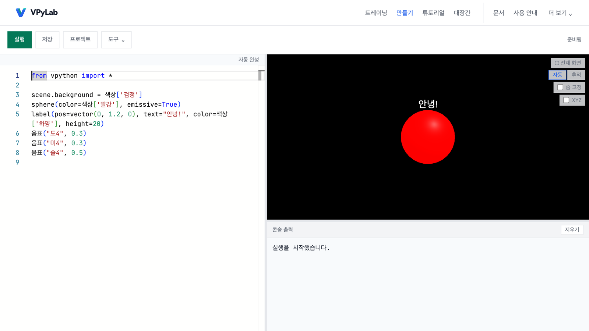

# VPyLab

**브라우저에서 실행하는 학교용 3D 파이썬 실습실 (빛과 소리 포함)**

VPyLab은 학교 수업용 3D 파이썬 실습실입니다. 학생이 VPython 방식의 파이썬 코드를 작성하면 3D 도형, 빛, 소리를 바로 확인할 수 있습니다. 파이썬은 Pyodide로 브라우저 안에서 실행되며 설치할 프로그램이 없고, 공개판은 계정 없이 사용할 수 있습니다.

[English](README.md) · 한국어

**바로 사용하기:** https://vpylab.pages.dev (영어 화면: https://vpylab.pages.dev/?lang=en)



```python
from vpython import *

scene.background = 색상['검정']
sphere(color=색상['빨강'], emissive=True)
label(pos=vector(0, 1.2, 0), text="안녕!", color=색상['하양'], height=20)
음표("도4", 0.3)
음표("미4", 0.3)
음표("솔4", 0.5)
```

위 코드를 **만들기** 화면에 붙여 넣고 **실행** 버튼을 누르면 결과를 확인할 수 있습니다. 결과는 빛나는 빨간 구, 그 위의 글자, 도·미·솔 세 음으로 나타납니다. `음표`와 `색상` 같은 한글 이름은 VPyLab 확장 기능이며, 영어 이름(`play_note_and_wait`, `color.red`)도 같은 결과를 냅니다. 도형, 벡터, `label`은 공식 VPython API를 따릅니다.

## 세 가지 방법으로 만들기

로그인 없이 시작하고, 필요한 만큼만 계정을 연결합니다. 방향과 결정은 [docs/GOOGLE_FIRST_PLAN.md](docs/GOOGLE_FIRST_PLAN.md)에 있습니다.

| 단계 | 필요한 것 | 할 수 있는 일 |
|---|---|---|
| 1. 혼자 만들기 | 없음 | 실행, 학습 자료, 공유 링크, **도구 → HTML 내려받기**·**파이썬 파일(.py) 내려받기**와 **파일 열기**. 작성하던 코드는 이 브라우저에 14일 동안 남습니다. |
| 2. 저장 | 구글 계정 | **저장**을 누르면 학생 본인의 구글 드라이브 VPyLab 폴더에 저장하고 다른 기기에서 엽니다. |
| 3. 팀 프로젝트 | GitHub 계정(선택, 13세 이상) | **팀 프로젝트**를 열어 둔 동안 저장이 GitHub 커밋이 됩니다. 팀원을 초대하고 기록을 남깁니다. |

- 내려받은 HTML 파일은 혼자 실행되며(인터넷 필요) 코드를 품고 있어, **파일 열기**로 VPyLab에 다시 불러올 수 있습니다.
- 구글 연결은 새로 고침해도 유지되고 탭을 닫으면 끊깁니다. 구글이 정한 약 1시간이 지난 뒤 저장하면 승인 창이 잠깐 열렸다 닫힌 뒤 저장이 이어집니다.
- 공개판의 팀 프로젝트는 브라우저가 GitHub와 직접 통신합니다. 로그인 코드를 토큰으로 바꾸는 요청 한 번만 작은 Pages 함수를 거치며, 이 함수는 아무것도 저장하지 않습니다. vpylab.pages.dev에서는 켜져 있고, 다른 배포는 GitHub OAuth 앱을 설정해야 켜집니다([설정 방법](docs/DEPLOY_TWO_EDITIONS.md)).
- 수업용 판(vpylab.vercel.app)은 2026-11-12에 구글 클라이언트 ID를 설정해 같은 흐름이 되었습니다. 팀 프로젝트는 지금도 운영 서버 방식이고, 전환 전에 계정에 저장한 코드는 그대로 남아 있습니다.

## 지금 상태

- 공개판 만들기 화면의 저장과 Ctrl/Cmd+S는 학생 본인 구글 드라이브의 VPyLab 폴더에 저장합니다. 처음 한 번 구글 계정으로 로그인하고 드라이브 권한을 승인합니다. 도구 줄의 내 드라이브에서 저장한 파일을 다시 엽니다. 다른 기기에서 먼저 저장했으면 충돌을 알립니다. 도구 → HTML 내려받기도 그대로 사용할 수 있습니다.
- 공개판에서도 **도구 → 공유**로 짧은 주소를 만들 수 있습니다. 이름을 정하면 vpylab.pages.dev/s/정한이름이 되고, 정하지 않으면 무작위 6자가 붙습니다. 주소나 QR 코드로 열면 실행 화면이 먼저 나오며, 임베드 코드도 제공합니다. 코드와 제목만 Cloudflare D1에 저장하며 로그인은 필요 없습니다. 이름을 정하면 공유 창을 열 때 먼저 만든 무작위 주소는 지워집니다(그 창에서 이미 복사·QR 코드·임베드·열기로 사용했다면 남습니다). 그러므로 이름을 정한 뒤에 나온 주소를 공유해야 합니다.
- **도구 → 영상으로 저장**은 3D 화면과 소리를 최대 30초 녹화합니다. 녹화는 브라우저 안에서 진행되며 서버로 영상이 전송되지 않습니다. 구글 드라이브를 연결했으면 내려받기와 드라이브의 VPyLab 폴더 안 `영상` 폴더에 저장하기 가운데 고르고, 연결하지 않았으면 바로 내려받습니다. 파일은 mp4이고, mp4로 녹화하지 못하는 브라우저에서는 webm입니다.
- 수업용 판(vpylab.vercel.app)에도 2026-11-12에 구글 클라이언트 ID를 설정했습니다. 학생은 ‘저장’과 ‘영상으로 저장’에서 본인의 구글 드라이브를 쓸 수 있습니다([설명](docs/DEPLOY_TWO_EDITIONS.md)). 2026-11-18에 실제 계정으로 파일을 드라이브에 저장한 뒤 다시 열어 확인했습니다. 미션 통과 기록은 계정에 연결됩니다. 다른 컴퓨터에서 로그인하면 기록이 복원되고, 로그아웃하면 그 컴퓨터에서 지워집니다.

## 두 가지 판, 하나의 코드

같은 코드를 두 가지 방식으로 빌드할 수 있습니다. 빌드 설정 `VITE_EDITION`으로 판을 선택합니다. 수업용 판(VPyLab Classroom)은 당곡고등학교 수업에서 사용 중이며, 2026-11-09부터 두 판 모두 이 저장소에서 배포합니다(수업용 판은 Vercel·Railway, 공개판은 Cloudflare Pages).

| | 공개판 | 수업용 판(VPyLab Classroom) |
|---|---|---|
| 주소 | https://vpylab.pages.dev | https://vpylab.vercel.app |
| 호스팅 | Cloudflare Pages(정적 파일 + 공유 주소·GitHub 로그인 함수) | Vercel + Railway(Express 서버) |
| 서버·데이터베이스 | 공유 주소용 Cloudflare D1(코드·제목만) | Supabase |
| 로그인 | VPyLab 계정 없음. 저장할 때 구글, 팀 프로젝트에서 GitHub를 브라우저에서 직접 연결 | 팀 프로젝트·갤러리·교사 도구에서 GitHub 또는 구글(Supabase Auth) |
| 저장 | 학생 본인의 구글 드라이브, 파일 내려받기와 열기 | 학생 본인의 구글 드라이브, 팀 프로젝트는 GitHub 저장소와 저장 이력 |
| 팀 프로젝트 | 서버 없는 GitHub 애드온(vpylab.pages.dev에서 켜짐) | 운영 서버 방식 |
| 갤러리 | GitHub 연동 갤러리(서버 없음, 교사 승인, 설정한 배포만) | 켜짐(Supabase) |
| 팀·교사 도구 | 꺼짐 | 켜짐 |
| 빌드 설정 | `VITE_EDITION=open` | 기본값(`classroom`) |

빌드와 배포 절차는 [docs/DEPLOY_TWO_EDITIONS.md](docs/DEPLOY_TWO_EDITIONS.md)에 있습니다.

## 학생과 교사

https://vpylab.pages.dev 에서 시작합니다. 상단 메뉴는 추천 순서대로 놓여 있습니다.

| 메뉴 | 하는 일 |
|---|---|
| **트레이닝** | 기초 8차시 「처음 만드는 빛과 소리」, 이어서 선택 과정인 핵심 연습 6단계(자동 검사)와 작품을 만든 뒤 고르는 「작품 저장과 공유」 4차시 |
| **만들기** | 파이썬 코드 작성과 실행. 편집기, 3D 화면, 콘솔 출력 |
| **튜토리얼** | 짧은 체험 네 가지와 「만들며 탐구하기」 프로젝트 |
| **대장간** | 슬라이더로 3D 오브젝트 하나를 만들고 코드 복사 또는 `.py` 내려받기 |
| **문서** | 항목 97개, 분류 12개의 VPython·VPyLab 참고 문서 |
| **사용 안내** | 앱 안의 사용 안내 |

만들기 화면의 **도구 → 예제**에는 8개 분야에 예제 58개가 있습니다. 자동 완성과 단어 도움은 AI 없이 동작하며, 학생 코드를 AI 서비스로 보내지 않습니다. 언어(한국어·English)와 테마는 **더 보기** 메뉴에서 변경할 수 있습니다.

코드에서 파이썬 패키지를 import할 수 있습니다. **실행**을 누르면 아직 설치하지 않은 패키지를 설치합니다. Pyodide가 함께 제공하는 패키지(numpy 등)는 Pyodide CDN에서, 그 밖의 순수 파이썬 패키지는 PyPI에서 받으므로 인터넷이 필요합니다. 패키지 이름이 자주 쓰는 모듈 이름과 한 글자만 다르면(예: `import numpi`) 철자 실수로 보고 설치하지 않습니다. 이때는 평소처럼 오류와 안내가 나옵니다. 내려받은 HTML 파일을 실행할 때도 같은 방식으로 패키지를 설치합니다.

안내서:

- [docs/GUIDE.ko.md](docs/GUIDE.ko.md): 공개판 교사·학생 안내서
- [docs/USER_GUIDE_KO.md](docs/USER_GUIDE_KO.md): 수업용 판 기준 안내서(로그인, 갤러리, 팀 프로젝트 포함)

<!-- TODO 화면 캡처: 트레이닝 화면(docs/screenshots/readme-training-ko.png), 캐릭터를 만든 대장간 화면(docs/screenshots/readme-forge-ko.png) -->

## 개인정보

### 공개판

공개판에는 VPyLab 계정이 없고, VPyLab이 개인정보를 저장하는 서버나 데이터베이스도 없습니다. 구글 로그인은 학생 본인의 드라이브에 저장할 때만, GitHub는 팀 프로젝트에서만 사용합니다. 사이트는 Cloudflare Pages의 정적 파일과 작은 함수 두 개(공유 주소, GitHub 로그인)로 이루어집니다. 저장소는 공유 주소용 Cloudflare D1 하나뿐입니다. ‘공유’를 누르면 코드와 제목만 저장됩니다. 요청 수를 제한할 때는 IP 주소를 변환한 값을 씁니다. 이 값은 1분마다 바뀌고, 2~3분이 지난 값은 그다음 요청이 들어올 때 지웁니다. IP 주소 자체는 저장하지 않습니다.

코드는 학생 브라우저 안에서 실행됩니다. 진행 기록, 테마, 언어, 메인 화면 설정과 만들기 화면에서 작성하던 코드(14일 뒤 삭제)는 이 브라우저(localStorage)에, 연습 초안은 브라우저 탭(sessionStorage)에 보관됩니다. 브라우저 데이터를 지우면 사라지며 다른 기기로 옮겨지지 않습니다.

웹 글꼴(Google Fonts, Fontshare)을 받을 때 외부 요청을 보냅니다. 앱은 대체 경로가 필요할 때 파일을 빨리 받을 수 있도록 jsDelivr와 unpkg에 미리 연결(preconnect)해 둡니다. 이 연결만으로는 파일을 받지 않습니다. 파이썬 엔진은 vpylab.pages.dev에서 받고, 여기서 받지 못했을 때만 jsDelivr나 unpkg에서 받습니다. 코드에서 import한 패키지는 실행할 때 내려받습니다. Pyodide가 함께 제공하는 패키지는 jsDelivr에서 받습니다. 파이썬 엔진을 unpkg에서 받았다면 이 패키지도 unpkg에서 받습니다. 그 밖의 패키지는 PyPI(`pypi.org`, `files.pythonhosted.org`)에서 받습니다. 내려받은 HTML 파일을 열면 jsDelivr에서 Pyodide와 Three.js를 불러옵니다(Pyodide는 unpkg도 사용). 코드에서 import한 패키지는 앱과 같은 방식으로 설치합니다. Pyodide가 함께 제공하는 패키지는 Pyodide를 받은 CDN에서, 그 밖의 패키지는 PyPI에서 받습니다.

팀 프로젝트(선택)에서 GitHub를 연결하면 `public_repo`, `repo:invite` 권한을 요청합니다. GitHub 토큰은 브라우저 탭 저장 공간에 있고, 로그인 코드를 토큰으로 바꾸는 함수는 토큰을 저장하거나 기록하지 않습니다. 프로젝트 저장소는 공개 저장소라 누구나 코드, 저장 기록, GitHub 아이디를 볼 수 있습니다.

### 구글 드라이브 저장

만들기 화면의 저장과 실험 페이지는 구글 로그인으로 openid email profile, drive.file 권한을 요청합니다. drive.file 권한으로는 이 앱이 만든 파일만 볼 수 있고 드라이브의 다른 파일은 볼 수 없습니다. 파일은 사용자 본인의 구글 드라이브 VPyLab 폴더에 저장되며 운영자는 접근할 수 없습니다. 구글 로그인 스크립트는 저장 창이나 내 드라이브 창을 열 때, 그리고 이 탭에 드라이브 연결이 남아 있을 때만 불러옵니다. 구글 접근 토큰은 브라우저 탭의 저장 공간(sessionStorage)에 있어 새로 고침해도 유지되고, 탭을 닫거나 로그아웃하면 사라집니다. 저장하지 못한 초안은 계정별로 이 브라우저에 남고, 14일이 지나면 그 컴퓨터에서 저장 창을 다시 열 때 지워집니다. 권한은 내 드라이브 창의 권한 철회 버튼이나 <https://myaccount.google.com/connections>에서 거둘 수 있습니다. 로그아웃할 때 이 계정의 초안을 지울지 묻습니다. 공용 컴퓨터라면 지우는 것이 안전합니다. 드라이브 저장을 위해 앱의 콘텐츠 보안 정책(CSP)에 더한 주소는 구글 로그인과 드라이브 API뿐이고, 실험 페이지는 구글과 자기 주소에만 요청합니다.

### 수업용 판

수업용 판은 계정을 Supabase에, 팀 프로젝트의 코드와 기록을 Supabase와 GitHub 저장소에 저장합니다. 개인 코드는 학생 본인의 구글 드라이브에 저장합니다. 자세한 내용은 수업용 판 화면의 개인정보 처리방침에서 확인할 수 있습니다.

## 구글 드라이브 저장

목표는 학생 코드를 학생 본인 구글 드라이브에 두고, 프로젝트는 학생 데이터를 보관하지 않는 것입니다. 만들기 화면의 저장과 실험 페이지는 Google Identity Services 토큰 방식과 `drive.file` 권한을 사용합니다.

2026-11-08에 개인 gmail 계정으로 시험을 진행했습니다. 통과 항목은 저장 후 다시 열기, 드라이브 버전 기록, 토큰 만료 뒤 다시 승인(초안 유지)입니다. 연속 저장 30회를 진행했으며 평균 3.0초, 오류 0건이 기록되었습니다. 네트워크 요청은 구글과 페이지 자신뿐이었습니다.

2026년 11월 8일에 구글 OAuth 앱을 프로덕션으로 게시하여 구글 계정이 있으면 누구나 승인할 수 있습니다. 이제 테스트 사용자로 등록할 필요가 없습니다. 학교 구글 워크스페이스 계정은 관리자가 외부 앱을 제한하면 승인이 막힐 수 있습니다. 구글 동의 화면의 드라이브 체크 상자는 처음에 비어 있으므로, 학생에게 체크하라고 안내합니다. 체크하지 않으면 다시 승인을 요청합니다. 액세스 토큰은 약 1시간 지속되며 갱신 토큰이 없습니다. 만료되면 코드를 초안으로 남기고 다시 승인을 요청합니다.

2026년 11월 8일 시험에서 당곡고(danggok.hs.kr) 교사 계정은 학교 관리자 설정 없이 승인되었고 저장도 되었습니다. 학생 계정은 학교마다 관리자 정책이 달라 아직 확인하지 않았습니다.

다른 학교에서 시험하는 방법은 [docs/TESTERS.ko.md](docs/TESTERS.ko.md)에 있습니다. 설정 방법과 시험 체크리스트는 [docs/DRIVE_LAB.md](docs/DRIVE_LAB.md)에 있습니다. 안정성 시험 결과와 고친 결함은 [docs/DRIVE_LAB_RESULTS_2026-11-08.md](docs/DRIVE_LAB_RESULTS_2026-11-08.md)에 있습니다. 전체 전환 계획은 [docs/GOOGLE_FIRST_PLAN.md](docs/GOOGLE_FIRST_PLAN.md)에 있습니다.

## 학교 정보 담당자

### 허용할 도메인

| 용도 | 도메인 |
|---|---|
| 앱 | `vpylab.pages.dev` |
| 웹 글꼴(막혀도 시스템 글꼴로 표시) | `fonts.googleapis.com`, `fonts.gstatic.com`, `api.fontshare.com`, `cdn.fontshare.com` |
| 파이썬 엔진 대체 경로, Pyodide가 함께 제공하는 패키지(numpy 등), 내려받은 HTML 파일 | `cdn.jsdelivr.net`, `unpkg.com` |
| 학생 코드에서 import하는 그 밖의 패키지(PyPI), 앱과 내려받은 HTML 파일에 모두 해당 | `pypi.org`, `files.pythonhosted.org` |
| 구글 드라이브 저장 | `accounts.google.com`, `www.googleapis.com`, `oauth2.googleapis.com` |
| 팀 프로젝트(GitHub, 선택) | `github.com`, `api.github.com`, `*.github.io` |

구글 드라이브 승인 창과 GitHub 로그인 창은 팝업으로 열립니다. `vpylab.pages.dev`의 팝업을 허용합니다.

### 구글 워크스페이스 계정(구글 드라이브 저장)

관리 콘솔의 **보안 → 액세스 및 데이터 제어 → API 제어 → 앱 액세스 제어**에서 OAuth 클라이언트 ID로 앱을 추가합니다. 설정값은 **제한됨** 또는 **신뢰함**이며, 드라이브를 제한된 서비스로 지정한 학교는 **신뢰함**으로 설정합니다. 메뉴 이름은 관리 콘솔 버전에 따라 다를 수 있습니다. 교육용 워크스페이스에서 18세 미만으로 지정된 사용자는 관리자가 설정하지 않은 외부 앱을 사용할 수 없습니다. 법이 요구하는 학부모 동의는 구글 정책상 학교 책임입니다. 대안으로 학교가 직접 배포하고 대상이 **내부**인 자체 OAuth 클라이언트를 사용하면 같은 도메인 계정만 사용할 수 있습니다.

## 개발자

**기술 스택:** React 19, Vite 8, Tailwind CSS 4, Monaco Editor, Three.js, Pyodide 0.27(Web Worker), Web Audio. 수업용 판에만 Express 5 서버와 Supabase가 있습니다.

**필요한 것:** Node.js 20.19 이상, 22.13 이상 또는 24 이상(Vite 8과 테스트 도구의 요구 사항, CI는 Node 24에서 실행)

```bash
git clone https://github.com/vpylab/vpylab.git
cd vpylab
npm install
cd client && npm install && cd ..
cd server && npm install && cd ..
```

**공개판 실행**(로컬에는 공유 주소 저장소가 없어 공유하면 긴 링크가 만들어집니다)

```bash
cd client
VITE_EDITION=open npm run dev        # http://localhost:4033
```

`VITE_GOOGLE_CLIENT_ID`가 없으면 **저장**을 눌렀을 때 드라이브에 저장하지 않고 설정 안내만 보여 줍니다.

**수업용 판 실행**(`.env` 파일에 Supabase 값 필요. `.env.example`, `client/.env.example`, `server/.env.example` 참고)

```bash
npm run dev                          # 클라이언트 4033 + 서버 4034
```

**그 밖의 명령**

| 명령 | 하는 일 |
|---|---|
| `npm --prefix client run test:run` | Vitest 단위 테스트 |
| `npm --prefix client run lint` | ESLint 검사 |
| `cd client && npm run build:open` | 공개판 빌드(`client/dist`). 서버 주소를 비우고 Cloudflare용 `_headers`·`_redirects` 생성 |
| `cd client && npm run build:deploy` | 수업용 판 빌드(본 앱 + 드라이브 실험), `vercel.json`과 같은 방식 |
| `cd client && npm run dev:drive-lab` | 드라이브 실험 http://localhost:4086/drive-lab.html |
| `npx wrangler pages dev client/dist --port 4087` | 빌드한 공개판을 Cloudflare Pages 방식으로 확인 |
| `npm run classroom:lan` | 교실 LAN 서버 모드([설명](docs/CLASSROOM_LAN_MODE.md)) |
| `npm run compat:check` | GlowScript 호환성 검사, Python 3.12 필요([보고서](docs/GLOWSCRIPT_COMPAT_REPORT.md)) |

**포트**

| 포트 | 용도 |
|---|---|
| 4033 | Vite 개발 서버(본 앱) |
| 4034 | Express 서버(수업용 판) |
| 4077 | 교실 LAN 모드 |
| 4086 | 드라이브 실험(OAuth 원본으로 등록되어 고정) |
| 4087 | Cloudflare Pages 로컬 확인 |

**저장소 구조**

| 경로 | 내용 |
|---|---|
| `client/` | React 앱, 파이썬 엔진(`src/engine/`), 학습 자료와 문서 데이터(`src/data/`), 드라이브 실험(`src/drive-lab/`) |
| `server/` | 수업용 판 Express 서버 |
| `api/` | 수업용 판 Vercel 함수: 링크 미리보기 카드, Railway 서버로 보내는 `/srv` 중계 |
| `functions/`, `cloudflare/` | 공개판 Cloudflare Pages 함수(짧은 공유 주소, GitHub 로그인)와 공용 코드, D1 표 구조 |
| `supabase/migrations/` | 수업용 판 데이터베이스 구조 |
| `scripts/` | GlowScript 호환성 검사, 갤러리 목록 만들기, 교실 도구, 연구 도구, 관리 스크립트 |
| `docs/` | 설계 기록, 배포·시험 보고서 |

**배포 문서**

- 두 판 배포: [docs/DEPLOY_TWO_EDITIONS.md](docs/DEPLOY_TWO_EDITIONS.md)
- 드라이브 실험과 자체 구글 OAuth 클라이언트: [docs/DRIVE_LAB.md](docs/DRIVE_LAB.md)
- 교사를 위한 수업용 판 단계별 배포(Supabase + 서버 + Vercel): [docs/DEPLOY_CLASSROOM.ko.md](docs/DEPLOY_CLASSROOM.ko.md)
- VPyLab이 지원하는 VPython API: [docs/VPYTHON_API.md](docs/VPYTHON_API.md)

서버나 데이터베이스가 필요한 새 기능은 `SERVER_FEATURES`(`client/src/lib/api-base.js`)로 감싸 공개판에서 꺼지게 합니다.

## 기여

교사, 학생, 개발자 모두 참여할 수 있습니다. [CONTRIBUTING.ko.md](CONTRIBUTING.ko.md)와 [행동 강령](CODE_OF_CONDUCT.md)을 먼저 읽습니다.

지금은 기능 동결 기간입니다. 버그 수정, 테스트, 번역, 학습 자료, 문서를 받고 새 기능은 미룹니다. 핵심 범위와 애드온 규칙은 [docs/SCOPE.md](docs/SCOPE.md)에 있습니다. 코드 구조는 [docs/ARCHITECTURE.md](docs/ARCHITECTURE.md)(영어), 전체 문서 목록은 [docs/README.md](docs/README.md)에 있습니다.

- 수업 자료와 미션: [docs/MISSION_SCHEMA.md](docs/MISSION_SCHEMA.md)
- 번역: [docs/I18N_GUIDE.ko.md](docs/I18N_GUIDE.ko.md). 지금 화면은 한국어와 영어를 지원합니다.
- 버그와 제안: [GitHub 이슈](https://github.com/vpylab/vpylab/issues)
- 보안 문제: 공개 이슈에 올리지 않고 [비공개 보안 신고](https://github.com/vpylab/vpylab/security/advisories/new)로 운영자에게 따로 알립니다.

## 라이선스

- 코드: AGPL v3 이상. 라이선스 전문은 [LICENSE](LICENSE), 저작권 고지는 [NOTICE](NOTICE)에 있습니다. Copyright (C) 2026 석리송 (Seok Ri-song) / 당곡고등학교 수리정보교육부
- 미션 콘텐츠: CC BY-NC-SA 4.0
- 포함한 외부 코드(MIT): `shapes`·`paths` 구현은 [vpython-jupyter](https://github.com/vpython/vpython-jupyter)의 `shapespaths.py`를 가져왔고, `compound`의 좌표 변환과 `text`의 위치 계산식은 같은 저장소의 `vpython.py`에서 이식했습니다(Copyright (C) 2015 John Coady, Ruth Chabay, Bruce Sherwood). `group`은 [GlowScript](https://github.com/vpython/glowscript)의 `lib/glow/primitives.js`(MIT)를 명세로 삼았습니다. 출처와 허가 문구는 `client/src/engine/vpython-api.py`의 해당 절에 있습니다.

## 감사의 말

VPyLab은 GlowScript와 VPython 프로젝트가 만든 VPython API를 따릅니다. 그 프로젝트의 사람들은 David Scherer, Bruce Sherwood, Ruth Chabay, John Coady와 기여자들입니다. 기반 라이브러리로 Pyodide, Three.js, Monaco Editor, React를 사용합니다.
