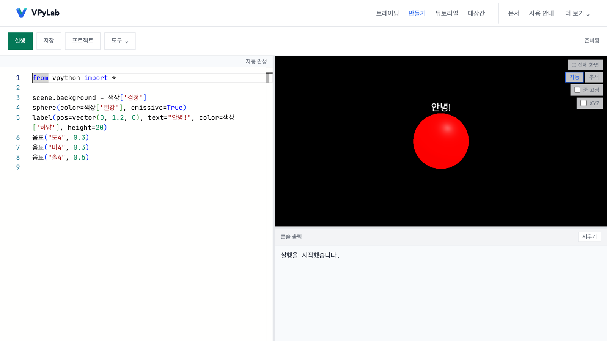

# VPyLab

**브라우저에서 실행하는 학교용 3D 파이썬 실습실 (빛과 소리 포함)**

VPyLab은 학교 수업용 3D 파이썬 실습실입니다. 학생이 VPython 방식의 파이썬 코드를 작성하면 3D 도형, 빛, 소리를 바로 확인할 수 있습니다. 파이썬은 Pyodide로 브라우저 안에서 실행되며 설치할 프로그램이 없고, 공개판은 계정 없이 사용할 수 있습니다.

[English](README.md) · 한국어

**바로 사용하기:** https://vpylab.pages.dev (영어 화면: https://vpylab.pages.dev/?lang=en)



```python
from vpython import *

scene.background = 색상['검정']
sphere(color=색상['빨강'], emissive=True)
label(pos=vector(0, 1.2, 0), text="안녕!", color=색상['하양'], height=20)
음표("도4", 0.3)
음표("미4", 0.3)
음표("솔4", 0.5)
```

위 코드를 **만들기** 화면에 붙여 넣고 **실행** 버튼을 누르면 결과를 확인할 수 있습니다. 결과는 빛나는 빨간 구, 그 위의 글자, 도·미·솔 세 음으로 나타납니다. `음표`와 `색상` 같은 한글 이름은 VPyLab 확장 기능이며, 영어 이름(`play_note_and_wait`, `color.red`)도 같은 결과를 냅니다. 도형, 벡터, `label`은 공식 VPython API를 따릅니다.

## 지금 상태

- 공개판 만들기 화면의 저장과 Ctrl/Cmd+S는 학생 본인 구글 드라이브의 VPyLab 폴더에 저장합니다. 처음 한 번 구글 계정으로 로그인하고 드라이브 권한을 승인합니다. 도구 줄의 내 드라이브에서 저장한 파일을 다시 엽니다. 다른 기기에서 먼저 저장했으면 충돌을 알립니다. 도구 → HTML 내려받기도 그대로 사용할 수 있습니다.
- 공개판에서도 **도구 → 공유**로 짧은 주소를 만들 수 있습니다. 이름을 정하면 vpylab.pages.dev/s/정한이름이 되고, 정하지 않으면 무작위 6자가 붙습니다. 주소나 QR 코드로 열면 실행 화면이 먼저 나오며, 임베드 코드도 제공합니다. 코드와 제목만 Cloudflare D1에 저장하며 로그인은 필요 없습니다. 이름을 정하면 공유 창을 열 때 먼저 만든 무작위 주소는 지워집니다. 그러므로 이름을 정한 뒤에 나온 주소를 공유해야 합니다.

## 두 가지 판, 하나의 코드

같은 코드를 두 가지 방식으로 빌드할 수 있습니다. 빌드 설정 `VITE_EDITION`으로 판을 선택합니다. 수업용 판(VPyLab Classroom)은 당곡고등학교 수업에서 사용 중이며, 2026-11-09부터 두 판 모두 이 저장소에서 배포합니다(수업용 판은 Vercel·Railway, 공개판은 Cloudflare Pages).

| | 공개판 | 수업용 판(VPyLab Classroom) |
|---|---|---|
| 주소 | https://vpylab.pages.dev | https://vpylab.vercel.app |
| 호스팅 | Cloudflare Pages(정적 파일 + 공유 주소 함수) | Vercel + Railway(Express 서버) |
| 서버·데이터베이스 | 공유 주소용 Cloudflare D1(코드·제목만) | Supabase |
| 로그인 | 없음 | 구글 또는 GitHub(Supabase Auth) |
| 저장 | 지금은 HTML 내려받기, 구글 드라이브는 시험 중 | 프로젝트, 저장 이력, GitHub 동기화 |
| 갤러리·팀·교사 도구 | 꺼짐 | 켜짐 |
| 빌드 설정 | `VITE_EDITION=open` | 기본값(`classroom`) |

빌드와 배포 절차는 [docs/DEPLOY_TWO_EDITIONS.md](docs/DEPLOY_TWO_EDITIONS.md)에 있습니다.

## 학생과 교사

https://vpylab.pages.dev 에서 시작합니다. 상단 메뉴는 추천 순서대로 놓여 있습니다.

| 메뉴 | 하는 일 |
|---|---|
| **트레이닝** | 기초 8차시 「처음 만드는 빛과 소리」, 이어서 선택 과정인 핵심 연습 6단계(자동 검사) |
| **만들기** | 파이썬 코드 작성과 실행. 편집기, 3D 화면, 콘솔 출력 |
| **튜토리얼** | 짧은 체험 네 가지와 「만들며 탐구하기」 프로젝트 |
| **대장간** | 슬라이더로 3D 오브젝트 하나를 만들고 코드 복사 또는 `.py` 내려받기 |
| **문서** | 항목 97개, 분류 12개의 VPython·VPyLab 참고 문서 |
| **사용 안내** | 앱 안의 사용 안내 |

만들기 화면의 **도구 → 예제**에는 예제 57개와 분야 8개가 있습니다. 자동 완성과 단어 도움은 AI 없이 동작하며, 학생 코드를 AI 서비스로 보내지 않습니다. 언어(한국어·English)와 테마는 **더 보기** 메뉴에서 변경할 수 있습니다.

안내서:

- [docs/GUIDE.ko.md](docs/GUIDE.ko.md): 공개판 교사·학생 안내서
- [docs/USER_GUIDE_KO.md](docs/USER_GUIDE_KO.md): 수업용 판 기준 안내서(로그인, 갤러리, 팀 프로젝트 포함)

<!-- TODO 화면 캡처: 트레이닝 화면(docs/screenshots/readme-training-ko.png), 캐릭터를 만든 대장간 화면(docs/screenshots/readme-forge-ko.png) -->

## 개인정보

### 공개판

공개판에는 계정이나 로그인이 없고, VPyLab이 개인정보를 저장하는 서버나 데이터베이스도 없습니다. 저장소는 공유 주소용 Cloudflare D1 하나뿐이며, 공유를 누를 때 코드와 제목만 저장됩니다. 코드는 학생 브라우저 안에서 실행됩니다. 진행 기록, 테마, 언어, 메인 화면 설정은 이 브라우저(localStorage)에, 연습 초안은 브라우저 탭(sessionStorage)에 보관됩니다. 브라우저 데이터를 지우면 사라지며 다른 기기로 옮겨지지 않습니다. 외부 요청은 웹 글꼴(Google Fonts, Fontshare)을 받을 때 이루어집니다. 파이썬 엔진은 vpylab.pages.dev에서 받으며, 실패할 때만 jsDelivr나 unpkg를 사용합니다.

### 구글 드라이브 저장

만들기 화면의 저장과 실험 페이지는 구글 로그인으로 openid email profile, drive.file 권한을 요청합니다. drive.file 권한으로는 이 앱이 만든 파일만 볼 수 있고 드라이브의 다른 파일은 볼 수 없습니다. 파일은 사용자 본인의 구글 드라이브 VPyLab 폴더에 저장되며 운영자는 접근할 수 없습니다. 구글 로그인 스크립트는 저장 창이나 내 드라이브 창을 열 때만 불러옵니다. 구글 접근 토큰은 페이지 메모리에만 있으며 새로 고침하면 사라집니다. 권한은 권한 철회 버튼이나 https://myaccount.google.com/connections에서 거둘 수 있습니다. 콘텐츠 보안 정책(CSP)은 만들기 화면에서 구글 로그인과 드라이브 API 주소만 더 허용합니다.

### 수업용 판

수업용 판은 계정과 코드를 Supabase에 저장합니다. 자세한 내용은 수업용 판 화면의 개인정보 처리방침에서 확인할 수 있습니다.

## 구글 드라이브 저장

목표는 학생 코드를 학생 본인 구글 드라이브에 두고, 프로젝트는 학생 데이터를 보관하지 않는 것입니다. 만들기 화면의 저장과 실험 페이지는 Google Identity Services 토큰 방식과 `drive.file` 권한을 사용합니다.

2026-11-08에 개인 gmail 계정으로 시험을 진행했습니다. 통과 항목은 저장 후 다시 열기, 드라이브 버전 기록, 토큰 만료 뒤 다시 승인(초안 유지)입니다. 연속 저장 30회를 진행했으며 평균 3.0초, 오류 0건이 기록되었습니다. 네트워크 요청은 구글과 페이지 자신뿐이었습니다.

2026년 11월 8일에 구글 OAuth 앱을 프로덕션으로 게시하여 구글 계정이 있으면 누구나 승인할 수 있습니다. 이제 테스트 사용자로 등록할 필요가 없습니다. 학교 구글 워크스페이스 계정은 관리자가 외부 앱을 제한하면 승인이 막힐 수 있습니다. 액세스 토큰은 약 1시간 지속되며 갱신 토큰이 없습니다. 만료되면 코드를 초안으로 남기고 다시 승인을 요청합니다.

2026년 11월 8일 시험에서 당곡고(danggok.hs.kr) 교사 계정은 학교 관리자 설정 없이 승인되었고 저장도 되었습니다. 학생 계정은 학교마다 관리자 정책이 달라 아직 확인하지 않았습니다.

다른 학교에서 시험하는 방법은 [docs/TESTERS.ko.md](docs/TESTERS.ko.md)에 있습니다. 설정 방법과 시험 체크리스트는 [docs/DRIVE_LAB.md](docs/DRIVE_LAB.md)에 있습니다. 안정성 시험 결과와 고친 결함은 [docs/DRIVE_LAB_RESULTS_2026-11-08.md](docs/DRIVE_LAB_RESULTS_2026-11-08.md)에 있습니다. 전체 전환 계획은 [docs/GOOGLE_FIRST_PLAN.md](docs/GOOGLE_FIRST_PLAN.md)에 있습니다.

## 학교 정보 담당자

### 허용할 도메인

| 용도 | 도메인 |
|---|---|
| 앱 | `vpylab.pages.dev` |
| 웹 글꼴(막혀도 시스템 글꼴로 표시) | `fonts.googleapis.com`, `fonts.gstatic.com`, `api.fontshare.com`, `cdn.fontshare.com` |
| 파이썬 엔진 대체 경로, 내려받은 HTML 파일 | `cdn.jsdelivr.net`, `unpkg.com` |
| 구글 드라이브 저장 | `accounts.google.com`, `www.googleapis.com`, `oauth2.googleapis.com` |

구글 드라이브 저장의 승인 창은 팝업으로 열립니다. `vpylab.pages.dev`의 팝업을 허용합니다.

### 구글 워크스페이스 계정(구글 드라이브 저장)

관리 콘솔의 **보안 → 액세스 및 데이터 제어 → API 제어 → 앱 액세스 제어**에서 OAuth 클라이언트 ID로 앱을 추가합니다. 설정값은 **제한됨** 또는 **신뢰함**이며, 드라이브를 제한된 서비스로 지정한 학교는 **신뢰함**으로 설정합니다. 메뉴 이름은 관리 콘솔 버전에 따라 다를 수 있습니다. 교육용 워크스페이스에서 18세 미만으로 지정된 사용자는 관리자가 설정하지 않은 외부 앱을 사용할 수 없습니다. 법이 요구하는 학부모 동의는 구글 정책상 학교 책임입니다. 대안으로 학교가 직접 배포하고 대상이 **내부**인 자체 OAuth 클라이언트를 사용하면 같은 도메인 계정만 사용할 수 있습니다.

## 개발자

**기술 스택:** React 19, Vite 8, Tailwind CSS 4, Monaco Editor, Three.js, Pyodide 0.27(Web Worker), Web Audio. 수업용 판에만 Express 5 서버와 Supabase가 있습니다.

**필요한 것:** Node.js 20 이상(CI는 Node 20과 24에서 실행)

```bash
git clone https://github.com/vpylab/vpylab.git
cd vpylab
npm install
cd client && npm install && cd ..
cd server && npm install && cd ..
```

**공개판 실행**(로컬에는 공유 주소 저장소가 없어 공유하면 긴 링크가 만들어집니다)

```bash
cd client
VITE_EDITION=open npm run dev        # http://localhost:4033
```

**수업용 판 실행**(`.env` 파일에 Supabase 값 필요. `.env.example`, `client/.env.example`, `server/.env.example` 참고)

```bash
npm run dev                          # 클라이언트 4033 + 서버 4034
```

**그 밖의 명령**

| 명령 | 하는 일 |
|---|---|
| `npm --prefix client run test:run` | Vitest 단위 테스트 |
| `npm --prefix client run lint` | ESLint 검사 |
| `cd client && npm run build:open` | 공개판 빌드(`client/dist`). 서버 주소를 비우고 Cloudflare용 `_headers`·`_redirects` 생성 |
| `cd client && npm run build:deploy` | 수업용 판 빌드(본 앱 + 드라이브 실험), `vercel.json`과 같은 방식 |
| `cd client && npm run dev:drive-lab` | 드라이브 실험 http://localhost:4086/drive-lab.html |
| `npx wrangler pages dev client/dist --port 4087` | 빌드한 공개판을 Cloudflare Pages 방식으로 확인 |
| `npm run classroom:lan` | 교실 LAN 서버 모드([설명](docs/CLASSROOM_LAN_MODE.md)) |
| `npm run compat:check` | GlowScript 호환성 검사([보고서](docs/GLOWSCRIPT_COMPAT_REPORT.md)) |

**포트**

| 포트 | 용도 |
|---|---|
| 4033 | Vite 개발 서버(본 앱) |
| 4034 | Express 서버(수업용 판) |
| 4077 | 교실 LAN 모드 |
| 4086 | 드라이브 실험(OAuth 원본으로 등록되어 고정) |
| 4087 | Cloudflare Pages 로컬 확인 |

**배포 문서**

- 두 판 배포: [docs/DEPLOY_TWO_EDITIONS.md](docs/DEPLOY_TWO_EDITIONS.md)
- 드라이브 실험과 자체 구글 OAuth 클라이언트: [docs/DRIVE_LAB.md](docs/DRIVE_LAB.md)
- 교사를 위한 수업용 판 단계별 배포(Supabase + 서버 + Vercel): [docs/DEPLOY_CLASSROOM.ko.md](docs/DEPLOY_CLASSROOM.ko.md)
- VPyLab이 지원하는 VPython API: [docs/VPYTHON_API.md](docs/VPYTHON_API.md)

서버나 데이터베이스가 필요한 새 기능은 `SERVER_FEATURES`(`client/src/lib/api-base.js`)로 감싸 공개판에서 꺼지게 합니다.

## 기여

교사, 학생, 개발자 모두 참여할 수 있습니다. [CONTRIBUTING.md](CONTRIBUTING.md)와 [행동 강령](CODE_OF_CONDUCT.md)을 먼저 읽습니다.

- 수업 자료와 미션: [docs/MISSION_SCHEMA.md](docs/MISSION_SCHEMA.md)
- 번역: [docs/I18N_GUIDE.md](docs/I18N_GUIDE.md). 지금 화면은 한국어와 영어를 지원합니다.
- 버그와 제안: [GitHub 이슈](https://github.com/vpylab/vpylab/issues)
- 보안 문제: 공개 이슈에 올리지 않고 [비공개 보안 신고](https://github.com/vpylab/vpylab/security/advisories/new)로 운영자에게 따로 알립니다.

## 라이선스

- 코드: AGPL v3([LICENSE](LICENSE)). Copyright (C) 2026 석리송 (Seok Ri-song) / 당곡고등학교 수리정보교육부
- 미션 콘텐츠: CC BY-NC-SA 4.0
- 포함한 외부 코드(MIT): `shapes`·`paths` 구현은 [vpython-jupyter](https://github.com/vpython/vpython-jupyter)의 `shapespaths.py`를 가져왔고, `compound`의 좌표 변환과 `text`의 위치 계산식은 같은 저장소의 `vpython.py`에서 이식했습니다(Copyright (C) 2015 John Coady, Ruth Chabay, Bruce Sherwood). `group`은 [GlowScript](https://github.com/vpython/glowscript)의 `lib/glow/primitives.js`(MIT)를 명세로 삼았습니다. 출처와 허가 문구는 `client/src/engine/vpython-api.py`의 해당 절에 있습니다.

## 감사의 말

VPyLab은 GlowScript와 VPython 프로젝트가 만든 VPython API를 따릅니다. 그 프로젝트의 사람들은 David Scherer, Bruce Sherwood, Ruth Chabay, John Coady와 기여자들입니다. 기반 라이브러리로 Pyodide, Three.js, Monaco Editor, React를 사용합니다.
