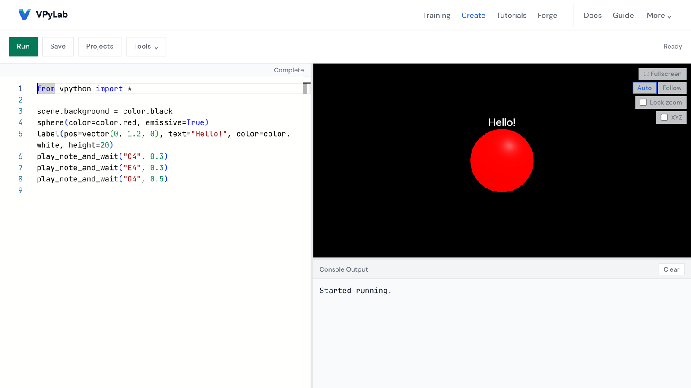

# VPyLab

**A 3D Python lab for schools, with light and sound, that runs in the browser.**

VPyLab lets students write VPython-style Python and see it as 3D shapes, light and sound right away. Python runs in the browser with Pyodide, so there is nothing to install and no account is needed to start.

English · [한국어](README.ko.md)

**Try it:** https://vpylab.pages.dev (English interface: https://vpylab.pages.dev/?lang=en)



```python
from vpython import *

scene.background = color.black
sphere(color=color.red, emissive=True)
label(pos=vector(0, 1.2, 0), text="Hello!", color=color.white, height=20)
play_note_and_wait("C4", 0.3)
play_note_and_wait("E4", 0.3)
play_note_and_wait("G4", 0.5)
```

Paste this into **Create** and press **Run**. A glowing red sphere and a label appear, and you hear C, E and G. `play_note_and_wait` is a VPyLab extension. Shapes, vectors, `label` and `color` follow the official VPython API.

## Three ways to work

You start without signing in and connect an account only when you need it.

| Step | You need | What you can do |
|---|---|---|
| 1. On your own | Nothing | Run code, follow the lessons, make share links, **Tools → Download HTML** or **Download Python file (.py)**, and **Open file**. Code you were writing stays in this browser for 14 days. |
| 2. Save | A Google account | **Save** stores the code in the `VPyLab` folder of the student's own Google Drive and opens it on another device. |
| 3. Team project | A GitHub account (optional, age 13+) | While a **team project** is open, Save makes a GitHub commit. Invite teammates and keep a record. The student gallery and the Forge's Community modules are built on this step. |

- A downloaded HTML file runs by itself (it needs the internet) and carries the code, so **Open file** loads it back into VPyLab.
- The Google connection survives a refresh and ends when the tab closes. Google limits a token to about one hour; when you save after that, the approval window opens and closes by itself and the save continues.
- Team projects talk to GitHub straight from the browser. A deployment turns them on by configuring a GitHub OAuth app ([how](docs/DEPLOY.md), Korean).

## One site, no server

VPyLab is one static site on Cloudflare Pages: https://vpylab.pages.dev. It has no application server, no database of its own and no account sign-in, and the operator stores no student data. The only server-side pieces are small Cloudflare Pages Functions for short share links (backed by a Cloudflare D1 database that holds the shared code and its title) and for the GitHub sign-in token exchange.

Until 2026-11-12 the same code was also deployed as a second "classroom edition" with its own server, database and accounts. That setup was removed and there is now one version. `vpylab.vercel.app` redirects to `vpylab.pages.dev`. The decision is recorded in [docs/SCOPE.md](docs/SCOPE.md).

## Status

VPyLab is in active development.

- **Save goes to the student's own Google Drive.** In Create, **Save** (or Ctrl/Cmd+S) signs in with Google once, asks for a file name, and saves to a `VPyLab` folder in the student's Drive. Later saves go to the same file. **My Drive** in the toolbar lists and reopens files. If another tab or device saved first, you choose: save a copy, load the Drive version, or overwrite.
- **Save as video**: **Tools → Save as video** records the 3D view and sound for up to 30 seconds, in the browser. Nothing is sent to a VPyLab server. With Google Drive connected you choose between downloading the file and saving it to a `영상` folder inside the `VPyLab` folder in your Drive; otherwise the file downloads. Files are mp4, or webm where the browser cannot record mp4.
- **Short share links**: **Tools → Share** creates a short link such as `vpylab.pages.dev/s/k7x2p9`, or `vpylab.pages.dev/s/your-name` if you choose a name (3–30 lowercase letters, numbers or hyphens; first come, first served). The link or its QR code opens straight to the running view (tap to start; the top-left button shows the source), and an embed code is available. Only the code and its title are stored, in Cloudflare D1. No sign-in is needed, and links do not expire. If you pick a name, the random link created when the Share window opened keeps working too.
- **GitHub team projects** work in deployments that configure a GitHub OAuth app.
- **Student gallery and Community modules** (both on GitHub, with teacher approval) are built but not turned on in production yet, and publishing with real GitHub accounts has not been verified end to end. Until the gallery list is turned on, **Gallery** shows the GlowScript original projects.

## For students and teachers

Start at https://vpylab.pages.dev. The top menu follows a suggested order:

| Menu | What you do there |
|---|---|
| **Training** | An 8-lesson foundation course, *Your first light and sound project*: predict, run, change one thing, explain. Then an optional 6-step practice on variables, loops, conditions and lists, with automatic checks. |
| **Create** | Write and run Python. Editor, 3D view and console side by side (tabs on a phone). **Stop** also ends scheduled sounds. |
| **Tutorials** | Four short experiences (3D, light and sound, motion, a button), then small projects to explore by making. |
| **Forge** | Shape one reusable 3D object with sliders, then copy its code or download a `.py` file. |
| **Gallery** | GlowScript original projects to read and run. Student work appears here once the gallery list is turned on. |
| **Docs** | 97 reference entries in 12 categories: shapes, vectors, scene, events, widgets, graphs, colors, materials, sound and more. |
| **Guide** | In-app instructions. |

More: 58 examples in 8 categories under **Create → Tools → Examples**. Editor completion and word help work without AI, and your code is not sent to an AI service. Switch language and theme under **More**.

Guides in this repository:

- [docs/GUIDE.ko.md](docs/GUIDE.ko.md): guide for teachers and students (Korean).
- [docs/USER_GUIDE_KO.md](docs/USER_GUIDE_KO.md) (Korean) and [docs/USER_GUIDE_EN.md](docs/USER_GUIDE_EN.md): feature guides for students.

These three guides were written before 2026-11-12 and are being revised. Where they disagree with this README, this README is current.

<!-- TODO screenshots: Training page (docs/screenshots/readme-training.png) and Forge with a character (docs/screenshots/readme-forge.png) -->

## Privacy

- There are no VPyLab accounts, and the operator keeps no personal information. The site is static files on Cloudflare Pages.
- Your code runs in your browser. The only thing the operator stores is what you share: pressing **Share** saves the code and its title in Cloudflare D1. A hashed IP address is used for rate limiting and is deleted when the next request arrives after two minutes; the IP address itself is never stored.
- Progress, theme, language and home settings are kept in your browser (localStorage). Practice drafts are kept in the browser tab (sessionStorage). Clearing browser data removes them, and they do not move to other devices.
- Third-party requests: web fonts from Google Fonts and Fontshare. The Python runtime is served from vpylab.pages.dev, with jsDelivr or unpkg as a fallback. Optional Python packages (for example numpy) are always downloaded from jsDelivr, so `import numpy` fails on a network that blocks it.
- A downloaded HTML file loads Pyodide and Three.js from jsDelivr or unpkg when opened.

**Saving to Google Drive**

- The Google sign-in script loads only when you open the save or My Drive window.
- It asks for `openid email profile` and `drive.file`. With `drive.file`, the app can see only the files it created, not the rest of your Drive.
- Files go to a `VPyLab` folder in the student's own Google Drive. VPyLab maintainers cannot see them.
- The Google access token is kept in the browser tab's storage (sessionStorage): it survives a reload and is gone when the tab closes or you sign out. Unsaved drafts stay in the browser, per account. Drafts older than 14 days are removed the next time the save window is opened on that computer.
- To remove access, press **Revoke access** in the My Drive window or go to https://myaccount.google.com/connections. Signing out offers to delete this account's drafts from the browser (do this on shared computers).

**GitHub (optional)**

- A student who chooses to connect is asked for the GitHub permissions `public_repo` and `repo:invite`. The browser then talks to `api.github.com` directly.
- The sign-in code is exchanged for a token by a Cloudflare Pages Function that stores and logs nothing. The token is kept in the browser tab's storage and is gone when the tab closes.
- Team projects are public repositories in the student's GitHub account. The gallery and Community modules lists are public files on the `gallery-data` branch of this repository; they hold repository names, titles, GitHub usernames and dates.

The in-app privacy page is at https://vpylab.pages.dev/privacy.

## Saving to Google Drive

Each student's code lives in their own Google Drive and the project keeps no student data. Save in Create uses Google Identity Services (token model) and the `drive.file` scope.

Tested on 2026-11-08 with a personal Gmail account:

- save and reopen, Drive version history
- re-approval after the token expired, with the draft kept
- 30 saves in a row: average 3.0 seconds, 0 errors
- network requests only to Google and the page itself

A wider stability run on the same day added a real one-hour token expiry, access revoked from outside the app, the Drive box left unchecked on Google's consent screen, two tabs and two devices editing the same file, injected network failures, timeouts, 429/5xx responses and lost responses, a file or the whole VPyLab folder moved to the Drive trash, and a teacher account on a school Google Workspace domain (approved without any admin setting). Saves never silently lost an edit; every failure kept a draft and explained what to do next. These runs used a separate test page that has since been removed; the storage modules it tested are the ones Create uses.

Limits today:

- The Google OAuth app was published to **Production** on 2026-11-08, so any Google account can approve it; no test-user registration is needed. All requested scopes (`openid`, `email`, `profile`, `drive.file`) are non-sensitive, so Google verification is not required.
- School Google Workspace accounts may need the Workspace admin to allow the app first. A teacher account at one school (danggok.hs.kr) worked without any admin change; student accounts have not been checked yet.
- Google's consent screen leaves the Drive box **unchecked** by default. Tell students to tick it, or the page will ask them to approve again.
- A Google access token lasts about one hour, and the token model gives no refresh token. When it expires, the page keeps your code as a draft and asks you to approve again.

Testing VPyLab at another school: [docs/TESTERS.ko.md](docs/TESTERS.ko.md) (Korean). Full stability results and the defects fixed: [docs/DRIVE_LAB_RESULTS_2026-11-08.md](docs/DRIVE_LAB_RESULTS_2026-11-08.md) (Korean).

## For school IT

**Domains to allow**

| Purpose | Domains |
|---|---|
| The app | `vpylab.pages.dev` |
| Web fonts (optional; the app falls back to system fonts) | `fonts.googleapis.com`, `fonts.gstatic.com`, `api.fontshare.com`, `cdn.fontshare.com` |
| Optional Python packages, the Python runtime fallback, and downloaded HTML files | `cdn.jsdelivr.net`, `unpkg.com` |
| Saving to Google Drive | `accounts.google.com`, `www.googleapis.com`, `oauth2.googleapis.com` |
| Team projects, gallery, Community modules (GitHub, optional) | `github.com`, `api.github.com`, `raw.githubusercontent.com`, `*.github.io` |

Allow pop-ups from `vpylab.pages.dev`; the Google and GitHub approval windows open as pop-ups.

**Google Workspace accounts (saving to Google Drive)**

- In the Admin console, add the app by its OAuth client ID under **Security → Access and data control → API controls → App access control**, and set it to **Limited** or **Trusted**. If your domain marks Drive as a restricted service, it must be **Trusted**. Menu names differ between console versions.
- In Google Workspace for Education, users designated as under 18 cannot use third-party apps the admin has not configured.
- Parental consent, where the law requires it, is the school's responsibility under Google's policy.
- A school can also host its own copy with its own OAuth client set to **Internal** audience. Only accounts in that domain can use it. See [docs/DEPLOY.md](docs/DEPLOY.md) (Korean).

## For developers

**Stack:** React 19, Vite 8, Tailwind CSS 4, Monaco Editor, Three.js, Pyodide 0.27 (in a Web Worker), Web Audio. Hosting is Cloudflare Pages, with Pages Functions and a D1 database for share links.

**Requirements:** Node.js 20.19+, 22.13+ or 24+ (CI runs Node 24). Python 3.12 for the tests that run lesson code.

```bash
git clone https://github.com/vpylab/vpylab.git
cd vpylab/client
npm install
npm run dev                          # http://localhost:4033
```

This needs no accounts, keys or database. The Vite dev server has no `/api/*`, so sharing falls back to a long link that carries the code. To turn on Drive saving or the GitHub features locally, copy `client/.env.example` to `client/.env.local` and fill in the values.

**Other commands**

| Command | What it does |
|---|---|
| `npm --prefix client run test:run` | Vitest unit tests |
| `npm --prefix client run lint` | ESLint |
| `npm --prefix client run build` | Build into `client/dist` |
| `npm test` | Tests for `shared/`, `cloudflare/` and `scripts/gallery/`, then the client tests |
| `npx wrangler pages dev client/dist --port 4086 --persist-to /tmp/vpylab-pages-dev-state` | Run a built site with the Pages Functions (`/api/*`). Local secrets go in a git-ignored `.dev.vars` |
| `npm run compat:check` | GlowScript compatibility checks ([report](docs/GLOWSCRIPT_COMPAT_REPORT.md)) |

**Ports**

| Port | Use |
|---|---|
| 4033 | Vite dev server |
| 4086 | Local Cloudflare Pages run (`wrangler pages dev`) |

**Repository layout**

| Path | Contents |
|---|---|
| `client/` | The React app: Python engine (`src/engine/`), lessons and docs data (`src/data/`), Drive saving (`src/drive/`), GitHub add-ons (`src/github/`, `src/gallery/`, `src/forge/`) |
| `functions/`, `cloudflare/` | Cloudflare Pages Functions (share links, GitHub token exchange), their logic, tests and D1 migrations |
| `shared/` | Modules used by the app, the functions and the scripts |
| `scripts/gallery/` | Builder for the gallery and Community modules lists |
| `scripts/compat/` | VPython compatibility harness |
| `scripts/research/` | Research tools kept outside the app |
| `docs/` | Design notes, deployment and test reports |

**More documents**

- Build, settings and deployment: [docs/DEPLOY.md](docs/DEPLOY.md) (Korean)
- Map of the code: [docs/ARCHITECTURE.md](docs/ARCHITECTURE.md)
- How teachers approve gallery work: [docs/GALLERY_GITHUB.md](docs/GALLERY_GITHUB.md) (Korean)
- VPython API supported by VPyLab: [docs/VPYTHON_API.md](docs/VPYTHON_API.md)

Deployment is automatic: merging to `main` runs CI, and when CI passes the "Deploy" workflow builds `client/` and deploys `client/dist` to Cloudflare Pages.

## Contributing

Teachers, students and developers are welcome. Read [CONTRIBUTING.md](CONTRIBUTING.md) and follow the [Code of Conduct](CODE_OF_CONDUCT.md).

VPyLab is in a feature freeze: bug fixes, tests, translations, lessons and documentation are welcome; new features wait. [docs/SCOPE.md](docs/SCOPE.md) explains the core and the add-on rule. For a map of the code see [docs/ARCHITECTURE.md](docs/ARCHITECTURE.md); for all documents see [docs/README.md](docs/README.md).

- Lessons and missions: [docs/MISSION_SCHEMA.md](docs/MISSION_SCHEMA.md)
- Translations: [docs/I18N_GUIDE.md](docs/I18N_GUIDE.md). The interface is in Korean and English today.
- Bugs and ideas: [GitHub issues](https://github.com/vpylab/vpylab/issues)
- Security problems: please do not post them in a public issue. [Report them privately](https://github.com/vpylab/vpylab/security/advisories/new) instead.

## License

- **Code:** GNU Affero General Public License v3 ([LICENSE](LICENSE)). Copyright (C) 2026 석리송 (Seok Ri-song) / 당곡고등학교 수리정보교육부.
- **Mission content:** CC BY-NC-SA 4.0.
- **Included MIT code:** the `shapes` and `paths` implementations come from `shapespaths.py` in [vpython-jupyter](https://github.com/vpython/vpython-jupyter). The `compound` coordinate transforms and the `text` positioning were ported from `vpython.py` in the same repository (Copyright (C) 2015 John Coady, Ruth Chabay, Bruce Sherwood). `group` follows `lib/glow/primitives.js` in [GlowScript](https://github.com/vpython/glowscript) (MIT) as its specification. Notices are in the matching sections of `client/src/engine/vpython-api.py`.

## Acknowledgments

VPyLab follows the VPython API created by the GlowScript and VPython projects (David Scherer, Bruce Sherwood, Ruth Chabay, John Coady and contributors). It is built on [Pyodide](https://pyodide.org), [Three.js](https://threejs.org), [Monaco Editor](https://microsoft.github.io/monaco-editor/) and [React](https://react.dev).
