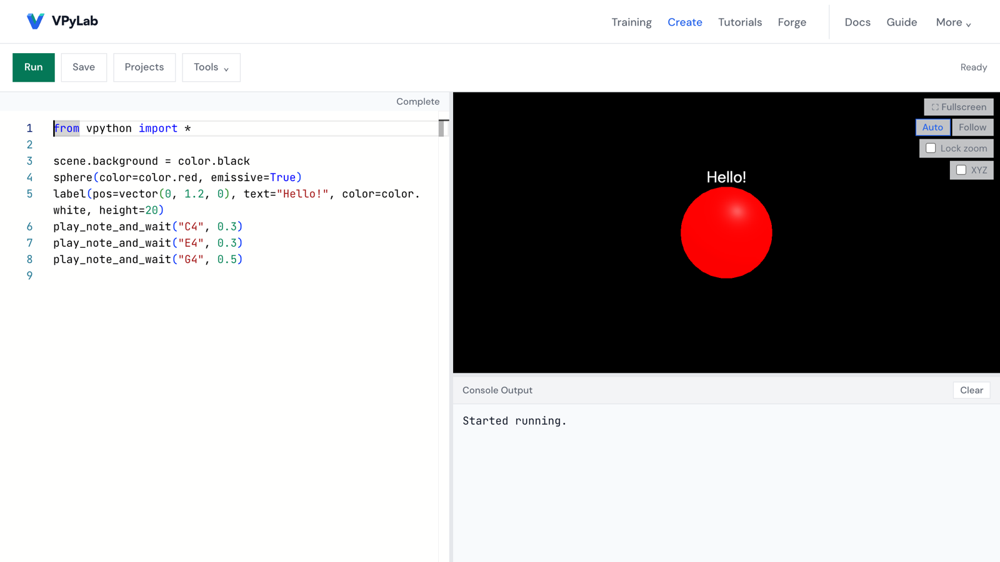

# VPyLab

**A 3D Python lab for schools, with light and sound, that runs in the browser.**

VPyLab lets students write VPython-style Python and see it as 3D shapes, light and sound right away. Python runs in the browser with Pyodide, so there is nothing to install. The open edition needs no account.

English · [한국어](README.ko.md)

**Try it:** https://vpylab.pages.dev (English interface: https://vpylab.pages.dev/?lang=en)



```python
from vpython import *

scene.background = color.black
sphere(color=color.red, emissive=True)
label(pos=vector(0, 1.2, 0), text="Hello!", color=color.white, height=20)
play_note_and_wait("C4", 0.3)
play_note_and_wait("E4", 0.3)
play_note_and_wait("G4", 0.5)
```

Paste this into **Create** and press **Run**. A glowing red sphere and a label appear, and you hear C, E and G. `play_note_and_wait` is a VPyLab extension. Shapes, vectors, `label` and `color` follow the official VPython API.

## Status

VPyLab is in active development. In the open edition (vpylab.pages.dev):

- **Save goes to the student's own Google Drive.** In Create, **Save** (or Ctrl/Cmd+S) signs in with Google once, asks for a file name, and saves to a `VPyLab` folder in the student's Drive. Later saves go to the same file. **My Drive** in the toolbar lists and reopens files. If another tab or device saved first, you choose: save a copy, load the Drive version, or overwrite. **Tools → Download HTML** still works.
- **Short share links**: **Tools → Share** creates a short link such as `vpylab.pages.dev/s/k7x2p9`, or `vpylab.pages.dev/s/your-name` if you choose a name (3–30 lowercase letters, numbers or hyphens; first come, first served). The link or its QR code opens straight to the running view (tap to start; the top-left button shows the source), and an embed code is available. Only the code and its title are stored, in Cloudflare D1. No sign-in is needed. If you pick a name, the random link created when the Share window opened is deleted, so share the link shown after naming.

## Two editions, one codebase

The same code is built two ways. The `VITE_EDITION` build setting picks the edition ([details](docs/DEPLOY_TWO_EDITIONS.md)).

| | Open edition | VPyLab Classroom |
|---|---|---|
| Address | https://vpylab.pages.dev | https://vpylab.vercel.app |
| Hosting | Cloudflare Pages (static files + share-link functions) | Vercel + Railway (Express server) |
| Server and database | Cloudflare D1 for share links only (code and title) | Supabase |
| Login | None | Google or GitHub (Supabase Auth) |
| Saving | The student's own Google Drive; HTML download | Projects, version history, GitHub sync |
| Gallery, teams, teacher tools | Off | On |
| Build setting | `VITE_EDITION=open` | default (`classroom`) |

The classroom edition is used in classes at Danggok High School. Since 2026-11-09 both editions deploy from this repository (Vercel and Railway for the classroom edition, Cloudflare Pages for the open edition).

## For students and teachers

Start at https://vpylab.pages.dev. The top menu follows a suggested order:

| Menu | What you do there |
|---|---|
| **Training** | An 8-lesson foundation course, *Your first light and sound project*: predict, run, change one thing, explain. Then an optional 6-step practice on variables, loops, conditions and lists, with automatic checks. |
| **Create** | Write and run Python. Editor, 3D view and console side by side (tabs on a phone). **Stop** also ends scheduled sounds. |
| **Tutorials** | Four short experiences (3D, light and sound, motion, a button), then small projects to explore by making. |
| **Forge** | Shape one reusable 3D object with sliders, then copy its code or download a `.py` file. |
| **Docs** | 97 reference entries in 12 categories: shapes, vectors, scene, events, widgets, graphs, colors, materials, sound and more. |
| **Guide** | In-app instructions. |

More: 57 examples in 8 categories under **Create → Tools → Examples**. Editor completion and word help work without AI, and your code is not sent to an AI service. Switch language and theme under **More**.

Guides:

- [docs/GUIDE.ko.md](docs/GUIDE.ko.md): guide for teachers and students on the open edition (Korean).
- [docs/USER_GUIDE_EN.md](docs/USER_GUIDE_EN.md): student guide written for the classroom edition. It covers login, gallery and team features that the open edition does not have.

<!-- TODO screenshots: Training page (docs/screenshots/readme-training.png) and Forge with a character (docs/screenshots/readme-forge.png) -->

## Privacy

**Open edition**

- There are no accounts or sign-in, and VPyLab keeps no personal information. The site is static files on Cloudflare Pages.
- Your code runs in your browser. The only thing stored is what you share: pressing **Share** saves the code and its title in Cloudflare D1. A hashed IP address is used for rate limiting and deleted within two minutes; the IP address itself is never stored.
- Progress, theme, language and home settings are kept in your browser (localStorage). Practice drafts are kept in the browser tab (sessionStorage). Clearing browser data removes them, and they do not move to other devices.
- Third-party requests: web fonts from Google Fonts and Fontshare. The Python runtime is served from vpylab.pages.dev; jsDelivr or unpkg is used only if that fails.
- A downloaded HTML file loads Pyodide and Three.js from jsDelivr or unpkg when opened.

**Saving to Google Drive** (Save in Create, and the test page https://vpylab.pages.dev/drive-lab)

- The Google sign-in script loads only when you open the save or My Drive window. The Content Security Policy of Create adds only the Google sign-in and Drive API origins; the test page talks only to Google and to itself.
- It asks for `openid email profile` and `drive.file`. With `drive.file`, the app can see only the files it created, not the rest of your Drive.
- Files go to a `VPyLab` folder in the student's own Google Drive. VPyLab maintainers cannot see them.
- The Google access token stays in page memory and is gone after a reload. Unsaved drafts stay in the browser, per account. Drafts older than 14 days are removed the next time the save window is opened on that computer.
- To remove access, press **Revoke access** in the My Drive window or go to https://myaccount.google.com/connections. Signing out offers to delete this account's drafts from the browser (do this on shared computers).

The classroom edition stores accounts and code in Supabase; see its in-app privacy page.

## Saving to Google Drive

The goal is that each student's code lives in their own Google Drive and the project keeps no student data ([plan](docs/GOOGLE_FIRST_PLAN.md)). Save in Create uses Google Identity Services (token model) and the `drive.file` scope. The same modules were first tested on a separate page, https://vpylab.pages.dev/drive-lab, which stays available for testing.

Tested on 2026-11-08 with a personal Gmail account:

- save and reopen, Drive version history
- re-approval after the token expired, with the draft kept
- 30 saves in a row: average 3.0 seconds, 0 errors
- network requests only to Google and the page itself

A wider stability run on the same day added a real one-hour token expiry, access revoked from outside the app, the Drive box left unchecked on Google's consent screen, two tabs and two devices editing the same file, injected network failures, timeouts, 429/5xx responses and lost responses, a file or the whole VPyLab folder moved to the Drive trash, and a teacher account on a school Google Workspace domain (approved without any admin setting). Saves never silently lost an edit; every failure kept a draft and explained what to do next.

Limits today:

- The Google OAuth app was published to **Production** on 2026-11-08, so any Google account can approve it; no test-user registration is needed. All requested scopes (`openid`, `email`, `profile`, `drive.file`) are non-sensitive, so Google verification is not required.
- School Google Workspace accounts may need the Workspace admin to allow the app first. A teacher account at one school (danggok.hs.kr) worked without any admin change; student accounts have not been checked yet.
- Google's consent screen leaves the Drive box **unchecked** by default. Tell students to tick it, or the page will ask them to approve again.
- A Google access token lasts about one hour, and the token model gives no refresh token. When it expires, the page keeps your code as a draft and asks you to approve again.

Testing VPyLab at another school: [docs/TESTERS.ko.md](docs/TESTERS.ko.md) (Korean). Setup and test checklist: [docs/DRIVE_LAB.md](docs/DRIVE_LAB.md) (Korean). Full stability results and the defects fixed: [docs/DRIVE_LAB_RESULTS_2026-11-08.md](docs/DRIVE_LAB_RESULTS_2026-11-08.md) (Korean).

## For school IT

**Domains to allow**

| Purpose | Domains |
|---|---|
| The app | `vpylab.pages.dev` |
| Web fonts (optional; the app falls back to system fonts) | `fonts.googleapis.com`, `fonts.gstatic.com`, `api.fontshare.com`, `cdn.fontshare.com` |
| Python runtime fallback, and downloaded HTML files | `cdn.jsdelivr.net`, `unpkg.com` |
| Saving to Google Drive | `accounts.google.com`, `www.googleapis.com`, `oauth2.googleapis.com` |

Allow pop-ups from `vpylab.pages.dev`; Google approval opens in a pop-up.

**Google Workspace accounts (saving to Google Drive)**

- In the Admin console, add the app by its OAuth client ID under **Security → Access and data control → API controls → App access control**, and set it to **Limited** or **Trusted**. If your domain marks Drive as a restricted service, it must be **Trusted**. Menu names differ between console versions.
- In Google Workspace for Education, users designated as under 18 cannot use third-party apps the admin has not configured.
- Parental consent, where the law requires it, is the school's responsibility under Google's policy.
- A school can also host its own copy with its own OAuth client set to **Internal** audience. Only accounts in that domain can use it. See [docs/DRIVE_LAB.md](docs/DRIVE_LAB.md).

## For developers

**Stack:** React 19, Vite 8, Tailwind CSS 4, Monaco Editor, Three.js, Pyodide 0.27 (in a Web Worker), Web Audio. Classroom edition only: Express 5 server and Supabase.

**Requirements:** Node.js 20 or later (CI runs Node 24).

```bash
git clone https://github.com/vpylab/vpylab.git
cd vpylab
npm install
cd client && npm install && cd ..
cd server && npm install && cd ..
```

**Run the open edition** (there is no share database locally, so sharing falls back to a long link):

```bash
cd client
VITE_EDITION=open npm run dev        # http://localhost:4033
```

**Run the classroom edition** (needs Supabase values in `.env` files; see `.env.example`, `client/.env.example`, `server/.env.example`):

```bash
npm run dev                          # client 4033 + server 4034
```

**Other commands**

| Command | What it does |
|---|---|
| `npm --prefix client run test:run` | Vitest unit tests |
| `npm --prefix client run lint` | ESLint |
| `cd client && npm run build:open` | Build the open edition into `client/dist` (clears server addresses, writes Cloudflare `_headers` and `_redirects`) |
| `cd client && npm run build:deploy` | Build the classroom edition (main app + drive lab), as `vercel.json` does |
| `cd client && npm run dev:drive-lab` | Drive experiment at http://localhost:4086/drive-lab.html |
| `npx wrangler pages dev client/dist --port 4087` | Check a built open edition with Cloudflare Pages behavior |
| `npm run classroom:lan` | Classroom LAN server mode ([docs](docs/CLASSROOM_LAN_MODE.md)) |
| `npm run compat:check` | GlowScript compatibility checks ([report](docs/GLOWSCRIPT_COMPAT_REPORT.md)) |

**Ports**

| Port | Use |
|---|---|
| 4033 | Vite dev server (main app) |
| 4034 | Express server (classroom edition) |
| 4077 | Classroom LAN mode |
| 4086 | Drive experiment (fixed; registered as an OAuth origin) |
| 4087 | Local Cloudflare Pages check |

**Repository layout**

| Path | Contents |
|---|---|
| `client/` | React app, Python engine (`src/engine/`), lessons and docs data (`src/data/`), drive experiment (`src/drive-lab/`) |
| `server/` | Express server for the classroom edition |
| `api/` | Vercel functions (link preview cards) for the classroom edition |
| `supabase/migrations/` | Database schema for the classroom edition |
| `docs/` | Design notes, deployment and test reports |

**Deploying**

- Both editions: [docs/DEPLOY_TWO_EDITIONS.md](docs/DEPLOY_TWO_EDITIONS.md)
- Drive experiment and your own Google OAuth client: [docs/DRIVE_LAB.md](docs/DRIVE_LAB.md)
- Step-by-step classroom deployment for teachers (Supabase + server + Vercel, Korean): [docs/DEPLOY_CLASSROOM.ko.md](docs/DEPLOY_CLASSROOM.ko.md)
- VPython API supported by VPyLab: [docs/VPYTHON_API.md](docs/VPYTHON_API.md)

New features that need the server or the database must be wrapped in `SERVER_FEATURES` (`client/src/lib/api-base.js`), so they stay off in the open edition.

## Contributing

Teachers, students and developers are welcome. Read [CONTRIBUTING.md](CONTRIBUTING.md) and follow the [Code of Conduct](CODE_OF_CONDUCT.md).

VPyLab is in a feature freeze: bug fixes, tests, translations, lessons and documentation are welcome; new features wait. [docs/SCOPE.md](docs/SCOPE.md) explains the core and the add-on rule. For a map of the code see [docs/ARCHITECTURE.md](docs/ARCHITECTURE.md); for all documents see [docs/README.md](docs/README.md).

- Lessons and missions: [docs/MISSION_SCHEMA.md](docs/MISSION_SCHEMA.md)
- Translations: [docs/I18N_GUIDE.md](docs/I18N_GUIDE.md). The interface is in Korean and English today.
- Bugs and ideas: [GitHub issues](https://github.com/vpylab/vpylab/issues)
- Security problems: please do not post them in a public issue. [Report them privately](https://github.com/vpylab/vpylab/security/advisories/new) instead.

## License

- **Code:** GNU Affero General Public License v3 ([LICENSE](LICENSE)). Copyright (C) 2026 석리송 (Seok Ri-song) / 당곡고등학교 수리정보교육부.
- **Mission content:** CC BY-NC-SA 4.0.
- **Included MIT code:** the `shapes` and `paths` implementations come from `shapespaths.py` in [vpython-jupyter](https://github.com/vpython/vpython-jupyter). The `compound` coordinate transforms and the `text` positioning were ported from `vpython.py` in the same repository (Copyright (C) 2015 John Coady, Ruth Chabay, Bruce Sherwood). `group` follows `lib/glow/primitives.js` in [GlowScript](https://github.com/vpython/glowscript) (MIT) as its specification. Notices are in the matching sections of `client/src/engine/vpython-api.py`.

## Acknowledgments

VPyLab follows the VPython API created by the GlowScript and VPython projects (David Scherer, Bruce Sherwood, Ruth Chabay, John Coady and contributors). It is built on [Pyodide](https://pyodide.org), [Three.js](https://threejs.org), [Monaco Editor](https://microsoft.github.io/monaco-editor/) and [React](https://react.dev).
